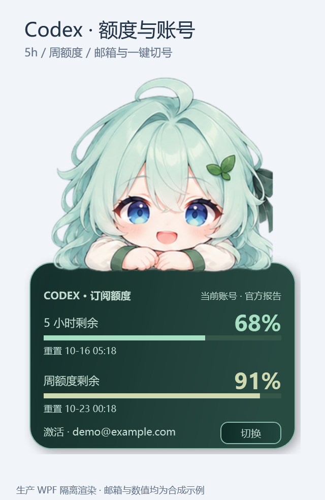
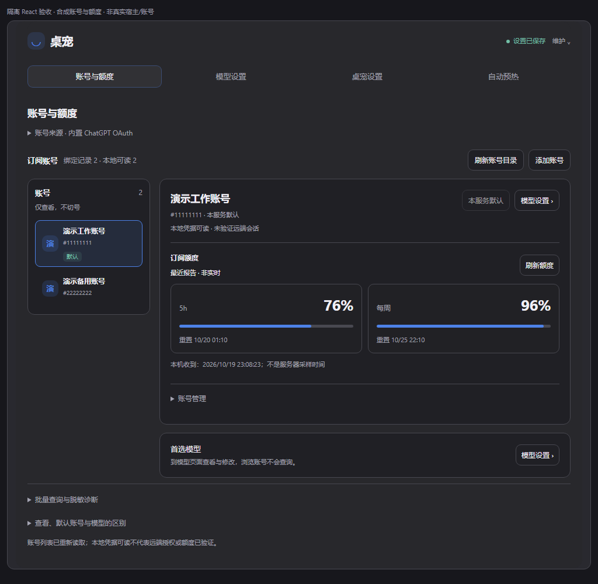
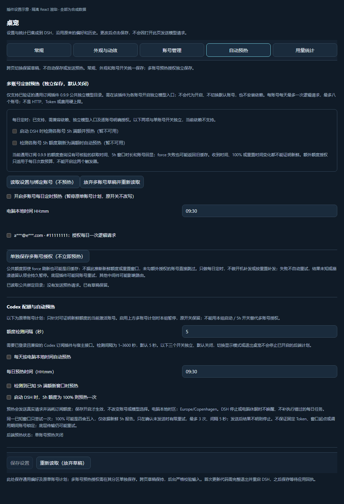
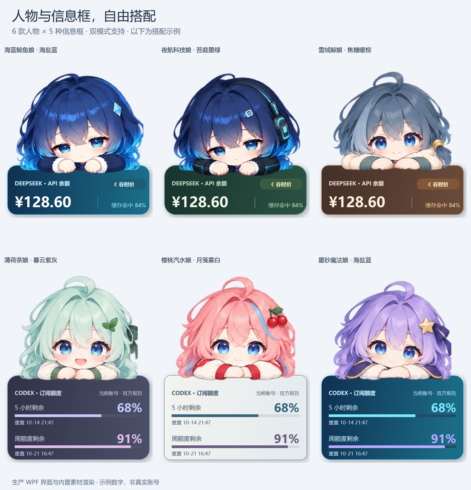

# dsh-plugin-simple-pet

**最新版：[v1.0.5 · 完整 B 设置与长会话图片兼容](https://github.com/YangShen-SWE/dsh-plugin-simple-pet/releases/tag/v1.0.5)** · [使用指南](USAGE.md) · [更新记录](CHANGELOG.md) · [安装包](https://github.com/YangShen-SWE/dsh-plugin-simple-pet/releases/latest/download/dsh-plugin-simple-pet.tgz)

陪你工作的 Windows 二次元桌宠：查看 DeepSeek 余额与 Codex 额度，六款人物与五种卡片自由搭配，支持简洁模式、顶部子页面设置。可选面板邮箱一键切号和逐账号授权的每日预热；均默认关闭，可选旧订阅插件或桌宠内置的官方组件账号服务；新版只安装桌宠一包。

A Windows anime companion for DeepSeek balances and Codex quotas, with six skins, five card themes, compact mode and tabbed settings. Optional panel account cycling and separately authorized daily account-bound warm-up can use a compatible legacy addon or the integrated official-component account service; both default off. Install only the simple-pet package.

## 界面展示 / Screenshots

部分设置截图来自此前版本，自动保存提示以当前界面与使用指南为准。面板使用生产 WPF 与内置人物素材渲染，设置使用真实 React 组件隔离渲染；邮箱、额度和预算均为合成演示，不含真实账号或用户数据，不代表正在运行宿主已验收。Panels use production WPF; settings use isolated production React. All accounts and values are synthetic, not live-host/account validation.










市场展示顺序由仓库根目录的 [screenshots.json](screenshots.json) 声明；图片更新在市场下一次目录构建与客户端刷新后显示。The catalogue discovers these images from the repository declaration on its next build.

> **兼容 / Compatibility:** 面向 DSH `0.2.0-rc.1`、`0.2.0-rc.2`；DeepSeek 功能已在 Windows + `0.2.0-rc.2` 实机验证，`rc.1` 尚待实机回归。Codex 额度需要宿主公共进程内连接；旧路径需支持的订阅插件，官方路径已内置于桌宠，安装包声明所需公开组件。旧独立账号包请在插件管理中停用后自行完整重启 DSH，不要删除账号数据或 grant。仅有 DSH 版本号不保证接口或真实账号资格可用。This is an unofficial community project, not a DeepSeek product.

> **v0.6.4 更新：** 新增「陪伴与舒适」：安静模式、经典／温和反馈、减少动态、关闭闪光／暴击标记、关闭用量飘字。安静停止在播视觉效果，真实余额、额度和统计继续更新，退出不补播；温和使用中性姿态与轻量确认。默认仍为经典，新开关关闭；保留六款人物、五款双模式信息框、右键无交互、拖动与原有预热偏好。升级不启用预热、不新增模型请求；升级后请完整退出并重启 DSH 一次。

## v1.0.5：完整 B 设置与长会话图片兼容

**更新原因：** 上一版只改了账号页，未完整实现选定方案；可选安装器的服务访问还可能隐藏设置入口。长会话内容错误则暴露了图片卸载控制信息丢失，最小短文本连接测试没有覆盖此类场景。

- **整套界面：** 账号与额度、模型设置、桌宠设置、自动预热四页统一；统计为二级入口，宽窄/深浅主题适配。账号浏览不切号，普通/模型偏好自动保存，消费与来源独立授权。
- **入口可靠：** 先注册设置，再在独立注入上下文接入可选安装器；缺失、晚到或卸载都不应隐藏“设置 → 桌宠”。
- **内容错误不再混为一谈：** 恢复真实 SDK 图片卸载的发送前控制信号及安全数量；附件服务/历史图片/工具历史错误分开，保留机器码，不暴露原始错误，不由插件自动重发或删除历史。
- **不夸大验收：** 旧截图具体触发子原因已丢失，不能宣称一定是图片超限；未为此重发真实请求，原生 replay 封装仍待专项验证。升级保留账号、偏好和预热记录，公共依赖不变，请自行完整退出（含托盘）并重开 DSH。

操作与边界见 [v1.0.5 使用指南](USAGE.md)、[更新原因和明细](CHANGELOG.md)、[隐私说明](PRIVACY.md)。下面的 v1.0.4 连接结果仅是当时最小请求的历史记录。

## v1.0.4：B 双栏工作台与模型目录兼容（2026-10-19）

- **B 双栏账号页：** 左边选查看对象，右边集中显示 5h / 每周额度、模型与管理入口；设置容器较窄时自动上下排列，适配明暗主题。
- **浏览不等于切号：** 点击或键盘导航只查看，不查额度、不读模型、不改默认；设本服务默认、刷新额度、更新模型与设 DSH 默认仍分别明确操作。
- **更简洁但不丢功能：** 管理、批量查询、脱敏诊断和来源说明默认折叠；普通/模型/昵称自动保存、草稿保护和消费授权边界不变。
- **大目录不再误判：** 8 MiB 有界解码读取替代旧 512 KiB，保留数量/时间/结构校验；超限单独分类，失败保留标旧模型缓存，不建议无依据地重新授权。
- **真实连接通过：** 界面完成并本地同步后，单独授权的当前默认绑定账号目录 GET 与 gpt-6.1-sol 最小请求均 HTTP 200，正常返回 OK；各一次，无自动重试、切号或预热。结论仅限该账号/时刻/最小生产服务链路，不代表所有账号、已有会话或运行中设置页都已验收。

完整操作见 [v1.0.4 使用指南](USAGE.md)，验证边界见 [产品评审](ACCOUNT-MANAGEMENT-REVIEW.md) 与 [隐私说明](PRIVACY.md)。升级保留账号、凭据、偏好及未知预热记录；公共依赖版本不变，请自行完整退出（含托盘）并重开 DSH。不会因升级、浏览设置或这次开发测试自动新增消费授权。

以下是历史版本记录，早期“待真实核验”描述按其当时状态保留，不覆盖上面的限定实测结论。

## v1.0.3：真正自动保存与多账号工具（2026-10-17）

- **设置自动保存：** 普通设置、账号模型偏好停止编辑约 450ms 后自动保存，不再显示常驻保存按钮；账号读取繁忙时排队续存。仅失败显示重试，冲突/结果未知不自动重发。预热、账号来源、切号入口及 DSH 默认模型仍独立确认，不夹带授权。
- **更清楚的界面：** 深浅主题的顶部状态和导航采用不透明底色，修复滚动内容透出；窄屏继续换行。
- **本机账号昵称：** 账号行可改名并自动保存，只改本地标签，不变账号身份、授权、默认、模型键或每日预算；代际冲突保留草稿。
- **主动批量额度：** 勾选后明确刷新，最多八账号、并发两个，每目标一次逻辑查询，支持取消及逐账号结果；不会打开页面就查全部账号，也不切号、调用模型或预热。
- **脱敏诊断下载：** 只从页面缓存生成白名单 JSON，先预览再本地下载，不上传，不含昵称、邮箱、账号键、凭据、路径、原始异常或账本。
- **目录兼容与证据：** 显式完整 GET 绕过 ETag，独立统计目标模型并显示后端能力与请求 profile；集中维护 `codex-models-v0.163.0`。这不是实账号恢复证明，**gpt-6.1-sol 仍待真实账号核验**，不虚构入口或自动重试结果未知的预热。

完整操作见 [v1.0.3 使用指南](USAGE.md)，实现和仍待核验/暂缓事项见 [账号管理待办](ACCOUNT-MANAGEMENT-REVIEW.md)。升级保留原偏好、账号、凭据和每日记录；请自行完整退出（含托盘）并重开 DSH。公共 SDK 依赖版本不变，不自动重启、不新增消费授权。

以下保留各历史版本的交付记录；早期“常驻保存按钮”“P1 待实现”等说明不代表 v1.0.3 当前状态。

## v1.0.2：多账号可管理、失败不连坐（2026-10-17）

本轮由产品、UX、架构共同评审，先修核心管理体验，不追平参考产品所有能力：单账号故障保留健康账号和固定模型入口；额度显示本机接收/重置时间，失败保留明确标旧的读数；移除采用目标确认和目录代际校验；真实 RPC 冲突穿过代理保留 409，草稿不丢失、不自动重试。全局服务故障仍整体关闭并冻结旧快照写入，不伪装成单账号故障。

不新增后台额度查询、自动切号、模型重试或预热授权，不把默认账号、DSH 默认模型和已有会话混为一谈。完整对照证据、首版验收与下一增量的改名/批量刷新待办见 [账号管理产品评审](ACCOUNT-MANAGEMENT-REVIEW.md)。离线通过不代表真实账号权限已验证；升级后自行完整重启 DSH。

## v1.0.1：自动保存与新模型兼容（2026-10-17）

普通外观、单位、休眠与刷新间隔等偏好在停止编辑约 450ms 后自动保存，状态区区分等待、保存中、已保存与失败；保存中继续编辑不会丢草稿。每账号的可见模型、首选模型与推理档位也自动保存，但不会自动设置 DSH 全局默认。初次读取不写入，跨子页面保留草稿；关闭整个设置组件会取消尚未发出的保存，请先确认已保存。

预热开关/时间、账号来源、桌宠切号入口和逐账号预热授权仍须明确确认；不会被普通偏好自动保存夹带。网络失败暂停自动重试，409 冲突保留草稿并要求明确放弃后重读；本地无效输入修正后可以恢复自动保存。偏好落盘与桌宠应用回执仍是不同状态。

对于账号在线目录确实返回、可见且支持的模型，若只省略可选上下文字段，不再因此过滤整个模型；使用明确标注的本地 8192-token 请求预算，不宣称服务端真实上限。无效的已提供上限仍拒绝，不添加服务端未返回的 slug，不把未知价格当免费，也不保证真实权限。可在「账号管理 → 模型 → 更新账号目录」核对 `gpt-6.1-sol` 是未返回、被隐藏、本地关闭还是能力不兼容；没有用真实账号/额度/模型调用验证。

参考 [Codex 订阅插件公开设置交互](https://github.com/WSL043/dsh-codex-subscription)，只借鉴编辑即保存与状态反馈，不读取它的授权或账号。完整安装、自动保存、账号/模型/额度与预热流程见 [使用指南](USAGE.md)。新版仅安装桌宠一个包；旧独立账号插件请停用或卸载并保留数据，再自行完整重启 DSH。

## v1.0.0：桌宠内置账号管理（2026-10-17）

- **一包安装：** 账号 OAuth、目录、模型路由、额度与每日预热已整合进桌宠；根包显式依赖 `@deepseek-ai/dsh-llm-pi-ai@0.2.0-rc.2`、`@earendil-works/pi-ai@0.87.1`。不再另发/要求安装账号插件，仍可选择旧订阅后端。
- **旧账号不搬家：** 保留 `codex-accounts/account-*` 凭据命名空间、原账号目录、模型路由、预算与偏好。已安装旧独立插件时先停用旧包，再手动完整重启一次；旧 owner 仍在运行时新版不会抢占服务或中断在途请求。不要删除目录或授权。
- **选择即刷新该账号目录：** 选择默认账号后更新它自己的模型目录；点击「模型设置」也显式刷新，重启后读取已保存 hints 必须先重新验证同账号，不再把 SDK 旧内置表当成已验证结果。失败仍保留已选账号，并明确说明目录未验证，不偷偷回退。
- **解释缺少 6.1-sol：** 区分未刷新/失败、服务端未返回、隐藏、不兼容元数据和本账号可见模型筛选；刷新不擅自打开已关闭模型。未知推理档位不再隐藏整个模型，但不会获得未知档位能力。没有硬编码模型权限，不承诺账号一定有该模型。

### 本版合入：正常对话与账号模型设置

- **正常对话而非只有预热：** 补接宿主 `attachments`/`fs`，离线复现并修复带截图历史在发送前失败；保留普通消息、工具调用/结果、图像与已报告用量，通用 temperature/stop 默认值不再误伤 Codex 通道。纯文本旧路径本可运行，不把所有失败都冒称同一原因。失败分层提示且不转发原始上游错误，取消/撤销仍结算 SDK 已报告用量，不假称成功或未发送。
- **每个账号自己的模型目录：** 在「账号管理 → 模型」显式更新目录，按该账号返回结果合并，不硬编码授权 `gpt-6.1-sol`，也不把未知价格当免费。兼容接口可能变化；目录、额度与请求成功是不同状态。内置 SDK 缺少的新模型可按已观察 slug 在重启后重新验证，持久 hints 不是权限，撤销即失效。
- **模型设置更直观：** 每账号选择提供哪些模型、首选模型与推理档位，单独保存；再点「设为 DSH 默认（固定此账号）」才提交并读回宿主全局模型设置。普通保存与账号默认不会偷偷修改宿主会话；已有会话需要在会话页手动换模。
- **模型名可读：** 新选择器提供 `账号键:gpt-…`，保留旧 `账号键:模型哈希` 已有会话兼容，不静默换账号或回退模型。该账号未返回某模型时不能凭此设置获得权限。

此轮参考本机已有 Codex 订阅插件的公开模型目录与设置流程，不读取其账号/凭据。验证采用私有 Temp、合成账号/HTTP/SSE、真实已安装官方 SDK 的离线序列化和隔离 React/Edge 窄屏截图；不等同真实订阅权限或服务器兼容验收。测试没有真实 OAuth/额度/模型调用、依赖安装、自动重启或关机；旧授权、预热预算和未知结果暂停规则保留。测试与发布证据见本版 Release，不把离线测试当作真实账号权限或运行宿主已验收。

### 本版合入：账号服务启动生命周期（2026-10-16）

再次收到「无法读取」截图后，宿主日志与当前公开 Cordis 4.0.4 的实际启动复现确认另有启动错误：`apply()` 的 Promise 返回了普通 service 对象。Cordis 仅收集函数/空值作为生命周期 effect，因 `TypeError: Invalid effect` 自动卸载插件和已经注册的通道；因此仅重启不能修复这个代码错误。

本地修复让入口完成注册后返回空值，service 仍由原有 lifetime effect 负责清理。传输/双插件测试不再把插件返回值当作服务 API；通过实际管理通道访问，并增加独立包的生命周期返回值回归。另用本机实际公开 Cordis 执行真实 `Context.plugin()`、依赖注入、通道存活和卸载检查，未替换生命周期收集器。缺路由提示也不再一概归因于未重启。

此修复已合入 v1.0.0；没有代登录、读取真实凭据/额度、调用模型或自动重启 DSH。真实账号授权仍需用户自行验收。以下旧版本记录保留历史双包说明，不是新版安装要求。

## v0.7.4：账号服务通道修复与简洁账号页（2026-10-16）

**更新原因：** 独立服务只注册了浏览器 HTTP 路由，而桌宠通过宿主进程内 Shared Fetch 注册表访问；两套注册表相互独立，导致插件已安装仍读取失败。本次同时发布桌宠 **0.7.4** 与独立账号服务 **0.1.1**，补齐真实内部通道，不以安装成功冒充已能登录。

- **通道与错误：** 在同一宿主 Connection 上注册内部 Fetch 和鉴权 HTTP 路由；随所属上下文卸载清理。浏览器仍鉴权优先；内部调用沿用 owner/admission 边界，不能当成公开无鉴权端点。固定区分未启用/404、权限、目录锁和暂时写入故障，不回显上游私密错误，也不自动重试 OAuth、额度或模型操作。
- **更简单的账号页：** 账号来源、刷新、添加账号、账号列表、默认/移除与额度查询集中显示，详细风险折叠但保留。登录方式使用浏览器/设备码官方交互；只有明确开始登录后才每两秒读取进度，GET 不重新提交登录。相同 prompt 保留已输入回调，完成、取消、换来源或卸载即停止；旧回调经来源往返切换也不能重新发送。
- **顶部保存：** 通用保存/重新读取与导航固定于可滚动区域顶部，窄屏换行并保持可见。跨页保留草稿；统计页也可提交通用草稿，多账号每日预热仍独立保存，不悄悄扩大授权。
- **取消与目录：** 正文读取期间取消不得首次分发登录、额度或预热；已经分发的操作不假称未发送。Windows 短暂共享冲突只有限重试同一份元数据原子 rename，最多十次，不重试任何账号/模型工作。
- **保持边界：** 默认仍为旧订阅路径，不迁移 grant、账号或预热授权；官方路径需分别安装两包。精确满额启动/5h 触发仍禁用。昵称不是官方邮箱，已保存与实际应用保持区分。本次不自动登录、查询真实额度、切账号或发模型请求。

定向验收与公开下载/本地复制证据写入本次 Release；仅合成账号、私有 Temp、真实公开宿主接口契约 mock，以及真实 React + 隔离 Edge 页面。没有执行完整测试套件，也不把这些结果当作真实 OAuth/运行宿主验收。界面截图中的账号和额度全部为合成数据。

**Update rationale:** the HTTP-only account service was absent from DSH's separate in-process Fetch registry. Desktop 0.7.4 + account service 0.1.1 register both transports with correct admission/lifecycle, harden cancellation and stale callbacks, simplify account management, and keep save/navigation visible at the top. Login polling is GET-only after explicit consent; budgets, defaults and full-trigger restrictions remain unchanged. Synthetic incremental tests and isolated browser checks are not live-account validation.

## v0.7.3：官方组件独立账号服务（2026-10-16）

**更新原因：** 默认官方 Codex OAuth 的单账号槽位不等于框架不能支持多账号；此前桌宠账号/额度/每日预热必须借助第三方订阅插件。本次新增独立插件 `dsh-plugin-codex-accounts@0.1.0`，复用官方公开 OAuth/适配器组件完成自有账号目录、账号固定请求和桌宠生产接线，不把 OpenAI Platform API Key 计费当成 ChatGPT 订阅额度。

- **两个独立包：** 安装并启用本次 Release 的 `dsh-plugin-codex-accounts.tgz` 与桌宠 `dsh-plugin-simple-pet.tgz`。账号服务显式依赖 `@deepseek-ai/dsh-llm-pi-ai@0.2.0-rc.2` 和 `@earendil-works/pi-ai@0.87.1`；不依赖第三方订阅插件，但不是零库依赖。桌宠自身仍无生产依赖，安装桌宠不会隐式安装/启用账号服务。
- **明确选择与登录：** 设置 → 桌宠 → 账号管理选择“官方组件独立账号服务”并保存，再主动读取目录、添加官方浏览器/设备码 OAuth、查询额度、选择新请求默认账号或撤销本地绑定。旧订阅路径仍为默认，不导入旧 grant、账号或预热授权。账号管理不受 DeepSeek/Codex 展示模式限制；查看账号与默认路由分开。
- **凭据和绑定：** grant 只经独立插件的固定账号 CredentialStore 进入宿主 credentials 服务，桌宠不接收令牌。刷新整个 mutation 受宿主锁保护；缺 grant、撤销、epoch/身份变化拒绝，不回退环境 Key、全局账号或其他账号。目录仅含不透明键、身份哈希、用户昵称及撤销/默认引用，不承诺宿主加密。昵称不是官方邮箱。
- **订阅额度：** 兼容 Codex 客户端的只读 GET，绑定 OAuth 账号头，失败保留旧采样时间并显示 stale；不调用模型或 reset-credit 消费接口。`clientObservedAt` 不是服务器采样证明，缺失账号回显、分钟/百分比舍入及后端延迟不伪装成精确满额。启动满额/5h 满额自动预热仍禁用。
- **默认与面板：** `codex-accounts` 独立模型路由的默认只影响后续新请求；在途 A 请求固定 A，不改宿主/第三方的 `openai-codex` 激活账号。面板仍需显式开启管理和至少两个可读 OAuth 绑定，点击轮换本服务新请求默认，显示用户昵称。旧后端的面板邮箱/全局切号语义保持原样。
- **每日预热：** 沿用默认关闭的独立逐账号授权，最多八个账号、每天每账号一次逻辑请求，未知额度仍需额外同意。官方发送前另检查普通用量权限和已知耗尽情况，固定账号、SSE、无工具及库重试0；实际 usage 只结算一次。不是 HTTP exactly-once/Token/费用硬上限。同订阅重绑预算键稳定，同日跨后端认领拒绝重放，unknown/崩溃认领仍暂停自动化；不恢复旧单账号计划或悄悄迁移授权。
- **架构与计划：** 将三项既有预热安全策略原样提取为 `warmup-safety.js`，旧导出不变。此前每日16:00任务已取消，未建立新定时。新增服务分离 OAuth/目录/额度/官方 driver，避免继续把账号存储塞进桌宠入口。后台新暂停优先于旧“保存成功”文案。

验证只用合成账号、私有 Temp、公开库假 OAuth 和双插件真实接线 mock；未真实登录/读取账号额度、调用模型、安装依赖、升级运行宿主或重启，也未跑全量测试。发布前源码定向通过 **499 项 Node 检查与 76,414 项隔离 WPF 断言**；源码/模拟通过不等于真实账号/完整宿主验收。兼容额度端点与 OAuth 资格仍受上游变更及政策约束，不能承诺一定开启新5h窗口。安装与安全边界见 [独立账号插件说明](codex-accounts/README.md)。

Official-component account service: this community plugin uses ChatGPT Codex subscription OAuth, not a Platform API key. Install the independent account-service asset explicitly; choose the saved official backend without migrating existing credentials or automation grants. Account-fixed refresh/request isolation, reported quota observations and opt-in daily warm-up are wired to the desktop client. Existing third-party paths remain the default. Exact-full startup/reset triggers remain unavailable. Validation used mocks/private temporary data only, not live authentication, billing calls or host restarts.

## v0.7.2：顶部子页面与多账号触发能力（2026-10-16）

**更新原因：** 设置选项增长后长页难以查找；此前仅在本地交付的独立账号每日预热、面板邮箱/切号和依赖安装入口尚未进入稳定包。本次按用户要求统一发布这些增量，并明确满额触发的公共接口证据缺口，不把不可用能力当作开关交付。

设置顶部按「常规 / 外观与动效 / 账号管理 / 自动预热 / 用量统计」切换，不再把所有选项堆在同一长页；支持左右方向键、Home/End，窄屏自动换行。跨页保留普通及多账号草稿，不隐式保存、安装依赖或读取绑定目录。通用偏好与原单账号计划统一显式保存，多账号授权仍独立保存并保留 CAS/冲突保护。

多账号新增**触发能力说明**：每日预算计划可用；「启动检测各账号满额」与「5h 刷新为满额自动预热」当前明确禁用，不是假开关。已核验的通用订阅 0.9.9 公共 usage 不提供原始获取时间、缓存失败回退状态、账号回显或保留的窗口时长；`force` 失败仍可能成功返回旧快照，不能根据收到时间、100% 或重置时刻变化触发收费请求。既有额外未知额度授权仅适用于每天一次逻辑预算，不能扩大为启动/每窗口授权。后台只读响应返回触发能力，伪造这些配置字段仍严格拒绝；没有新增额度轮询或模型调用。接口证据和未来接入条件见 [多账号限制说明](MULTI-ACCOUNT-NOTES.md)。

v0.7.2 源码发布前定向检查通过 **437 项 Node 检查 + 76,414 项隔离 WPF 断言**（仅新/受影响内容，未跑全量）。独立 Edge + 真实 React 的合成数据页面检查通过，包含 380px 外层容器换行、不溢出和切页零新增请求；不是已运行宿主或真实账号验证。

v0.7.2 partitions settings into five keyboard-accessible top-navigation pages and preserves drafts across navigation. Daily multi-account scheduling remains available, but startup-full/reset-full controls are visibly unavailable because the reviewed public quota contract cannot prove sample freshness or the exact five-hour window. Development and release validation made no real account/model calls, dependency installation or automatic restart; no broader billing consent was enabled. Real refreshed-host validation remains outstanding.

## v0.7.2：面板多账号管理（2026-10-16）

- **设置入口：** DSH → 设置 → 桌宠 → 账号管理（Codex 模式），默认关闭，勾选后显式保存。设置页不再提供账号列表、目标选择或二次确认切号；这里只配置功能与安装依赖。
- **面板操作：** 开启后 Codex 卡片底部增加邮箱和「切换」。点击即尝试切至公共列表中下一个账号，无额外确认；仅在至少两个有效去重绑定账号、唯一当前账号、精确支持版本且本插件没有预热／切号／未知结果隔离时可用。按公共列表顺序循环，不代管登录；额度过期不冒充新鲜，但不因旧额度缓存锁死恢复切号。仍会读取并复核最新账号列表，不能保证上游凭据有效或其他插件全局无在途请求。
- **依赖与安装：** 账号应先在 `dsh-codex-subscription@2.6.8` 或 `dsh-plugin-subscriptions@0.9.9` 绑定。设置提供用户主动确认的通用订阅插件 `0.9.9` 安装入口，通过宿主公共 pluginManager 执行；不是开关自动安装。已有同名插件（包括旧版、禁用版）不升级、降级或自动启用；缺安装 API／权限则提示手动使用 Plugins 管理。不开启构建脚本授权，待审脚本／需重启不伪报就绪。宿主缺少原子 ifAbsent，其他操作并发安装仍有竞态，勿同时管理同一依赖。
- **隐私与安全：** 完整邮箱仅在开启管理后显示于本机 WPF 内存（过长省略，悬停可看完整地址），没有邮箱则明确提示，不从 label 猜测。由随机能力令牌保护的临时 IPv4 回环通道传递，拒绝浏览器 Origin，不落盘邮箱或令牌；同用户恶意进程不在该隔离保证内。关闭、换来源、过期或退出会清除原身份。卡片仅增加 28 逻辑像素，经典／简洁、主题与尺寸仍兼容；右键继续无交互。
- **共享副作用：** 一键切号改变 DSH 共享激活／默认账号，可能影响连接、模型缓存及已授权预热，通用默认账号不等于 Pool 的实际请求账号。一次点击不自动重试／回滚；已尝试但结果不明则隔离后续切号和自动预热，需在订阅插件核验再完整重启。本次开发与发布验证未真实安装依赖、切号、调模型或重启；完整宿主及真实账号仍待验收。定向验证通过 398 项 Node 检查及 2196 条原生断言（含面板409、身份887、回执214、尺寸438、偏好216、额度展示32），未跑全量测试；截图只用合成邮箱与额度。

v0.7.2 panel management is explicit opt-in: settings provide dependency help/installation, while the WPF card shows the public email and cycles accounts on one click without a second dialog. Fresh two-account controller checks, reviewed exact versions, shared-account warnings and unknown-result quarantine remain. A memory-only capability-authenticated loopback channel carries the panel email; no account email or channel secret is persisted. Installation is explicit, public-host-only, avoids changing existing same-name addons and grants no build scripts. Real host/account and installation validation were not performed.

## v0.7.2：多账号每日定时 warm-up（2026-10-16）

- **入口：** DSH → 设置 → 桌宠 → Codex 模式 → 多账号定时预热。主动读取绑定目录，逐账号选择模型、授权，再**单独保存**；打开页面、读取及保存均不执行预热。独立设置默认关闭，不混入视觉偏好保存。
- **兼容门控：** 仅接入已静态核验的 `dsh-plugin-subscriptions@0.9.9` 公共独立账号模型目录与宿主模型 API。需自行在该插件开启账号的独立模型入口；桌宠不安装或开启它。本机只有 `dsh-codex-subscription@2.6.8` 时仍不可用；不是所有 Codex 订阅插件都支持此功能。新版面板管理提供显式依赖安装入口，但不会自动安装，也不代为开启独立模型。
- **固定账号而非轮流切号：** 从公共 `listModels('codex')` 枚举精确独立条目，发送前重新校验账号、模型与解析结果；只按该条目调用，不拼接路由、不改默认／激活账号、不回退 Pool 或其他账号。删除／撤销绑定则跳过。
- **授权与预算：** 最多八个账号，串行，每个账号每天最多一次逻辑请求。公共额度没有可靠原始获取时间，`force` 也可能返回缓存，所以默认跳过；需对每账号额外勾选“额度新鲜度无法证明时仍按每日预算尝试”。此限制**不是 HTTP 次数、Token 或费用硬上限**，底层同账号重试和宿主中间件仍由其管理，不保证开启官方窗口。
- **调度与去重：** 使用电脑本地 HH:mm；不在开机、开启设置、长休眠恢复或时钟回拨后补发。不做按 5h 重置补发。发送前原子持久认领，换模型不能绕过同日账号去重；只要可能已发送却结果未知或遗留崩溃认领，全部自动预热持久暂停，不自动重试。保存／关闭开关不清除认领，不要删除去重记录来补发。
- **原功能保留与交叉去重：** 开启多账号计划期间，暂停旧单账号计划但不改写其三个开关；运行中改授权或切换计划模式会保守暂停。旧单账号当天已有尝试／认领时，新计划保守整日跳过；当天已有多账号认领时，旧计划即使关闭新开关并重启也不补发。任一日志损坏则停止自动预热、不覆盖记录。既有已启用预热仍有真实请求及额度消耗风险；本次安装不会启用任何计划。多账号预热本身不改变人物外观或右键；后续面板管理增量可独立启用邮箱与切号。
- **定向验证：** 源码通过 358 项新增／直接受影响 Node 检查及 1101 条原生断言（身份 887、回执 214），没有执行全量测试。独立只读复审发现的连接失效后迟到调用、未知结果解除暂停、旧日志覆盖和跨计划重启重复风险均补充了模拟回归；这不是完整宿主或真实账号验收。模型元数据最低 reasoning 与计费异常也采用保守失败，不隐含增大预算。
- **隐私与验收边界：** 独立 `multi-warmup.json` 仅存账号／精确模型哈希、授权、日期和尝试终态；遮罩邮箱仅在设置页内存显示，不写原始账号、模型绑定 ID、邮箱、令牌或回复。当前仅 mock／私有临时文件测试；未真实访问账号、发送模型请求、安装订阅插件或重启 DSH。真实宿主／绑定账号效果尚未验收；本增量已纳入 v0.7.2，安装或升级不会代为开启。

v0.7.2: opt-in daily multi-account warm-up via reviewed subscriptions 0.9.9 public independent model entries, never shared-account rotation or Pool fallback. Separate explicit per-account grants, at most eight accounts and one logical request/account/day; unknown quota freshness requires extra consent. This is not a hard HTTP/token/cost cap. Persist claims before dispatch; unknown outcomes pause all automation, without retry or startup catch-up. Defaults stay off; no live account/model validation or automatic restart was performed.

## v0.7.1 更新重点：明确确认切号，能力不足不强开（2026-10-15，历史发布）

> **版本号更正：** 此功能版本按用户要求从此前的 v0.8.0 调整为 v0.7.1；运行代码相同。本次仅校验版本、包内容及发布指向，不重复执行下述已通过的功能测试；旧标签仅保留历史。

按用户新要求，第二任务提前到今天完成可安全交付的部分，**原 2026-10-16 16:00 Europe/Copenhagen 定时已取消**。

- **入口与条件：** DSH → 设置 → 桌宠 → Codex 账号与共享切换，主动点击读取，再选目标、查看影响并单独确认；不混入偏好保存。只有同来源公共列表返回至少两个有效去重已绑定账号、唯一选中账号、已核验切号能力且本地不忙碌，才允许确认。单账号／未知／过期／重复／多选中／缺接口均不可切换。
- **已核验版本门控：** 专用插件 `dsh-codex-subscription@2.6.8` 使用公共 account/select；通用插件 `dsh-plugin-subscriptions@0.9.9` 使用公共 setDefault。仅这些已静态核验的精确版本启用写能力，未知版本保留只读查询；不自动安装、升级或登录。通用默认账号不是 Pool 每次请求的执行账号保证。
- **共享副作用：** 改变 DSH 共享激活／默认账号，可能关闭连接、刷新模型与缓存，不能保证所有在途请求原子切换。列表有效期 15 秒，确认再次重读来源、成员、当前和目标；一次最多一次写，成功须重读验证。切号 RPC 本身不调模型，原先已开启的预热仍可能按旧条件在新激活账号运行。
- **结果不明保守暂停：** RPC 有整体超时，但超时不能撤回上游已发出的写。未获最终确认时，本插件暂停后续切号和自动预热，普通额度仍可刷新；请在订阅插件核验后完整退出并重启 DSH，不自动重试、回滚或凭一次状态读取解锁。来源 A→B→A 也撤销旧确认；取消、换目标或卸载后旧页面回调不能提交。
- **多账号 warm-up 仍不可用：** 已提供明确能力状态和原因；本机缺少经过集成验证的公开账号绑定调用及逐账号预算授权，不后台轮换共享账号模拟。多账号额度列表、WPF 卡片切号按钮与完整邮箱展开也未交付：WPF 尚无可信命令 IPC，设置页入口不冒充面板按钮。
- **验证范围：** 源码通过 160 项新增／受影响 Node 检查、1101 条原生断言（身份 887、回执 214），仅 mock 公共 RPC、私有临时文件及隐藏 WPF。未跑全量、未真实切号／读凭据／调模型／自动重启。真实宿主、实际依赖账号和多 DPI 仍待明确授权的实机验收。

v0.7.1 adds explicit, separately confirmed shared active/default account switching in native settings, gated on two fresh valid bound accounts and reviewed exact addon versions. It does not add a WPF action button or enable multi-account warm-up. Unknown write outcomes quarantine subsequent local switching and automatic warm-up until the user verifies upstream and fully restarts DSH; a timeout cannot cancel an already sent mutation. Existing opt-in schedules are preserved, and may resume after a successfully verified switch. The originally scheduled follow-up was cancelled and its safe increment delivered today. No live account/model tests or full-suite claim. See [scope and remaining decisions](ACCOUNT-ROADMAP.md).

## v0.7.0 更新重点：先看清账号，再安全切换（2026-10-15，历史首期）

**更新原因：** 多账号用户需要知道额度属于哪个来源及账号；但切换公共订阅账号会影响 DSH 共享连接，收费预热还需要可靠账号绑定。经产品、UX、架构评审，本次先交付只读识别，不把高副作用操作藏进普通设置保存。

- **面板：** Codex 卡片标题显示“激活 #匿名短标识”或“默认 #匿名短标识”，保留额度／重置状态、五主题、四尺寸与简洁模式；不显示完整或遮罩邮箱、不新增点击或右键行为。
- **邮箱：** DSH → 设置 → 桌宠，选择 Codex 模式，可看到公共接口提供的脱敏邮箱；无有效邮箱显示“邮箱未提供”。例如 `a***@e***.com · #abcdef01`，不是完整邮箱。通用插件的“默认账号”不保证是某次模型请求的实际执行账号。
- **隐私与正确性：** 复用既有额度查询，不新增上游轮询；只读鉴权内存接口显示邮箱，原始邮箱及遮罩都不进入桌宠快照、统计、偏好或日志。前后账号不一致、来源变化、过期／异常时不将旧邮箱配给新额度。不会根据标签或 opaque ID 猜邮箱。
- **本版未实现：** 切号按钮、多账号额度列表、多账号 warm-up、完整邮箱展开。明天的任务继续安全切号与预热适配；不具备公共账号绑定或需用户决定时可以明确暂缓，不能后台循环切号替代。
- **后续切号启用条件（用户要求）：只有先在受支持的其他订阅插件绑定至少两个 Codex 账号，按钮才可启用。** 还须有同来源新鲜、有效去重公共列表和切号接口，非 busy／本地预热中；单账号、未登录、缺插件、列表未知／过期／失败均禁用并解释，确认前再次核验。当前 v0.7.0 没有假可用按钮，桌宠不代管登录。
- 当时登记第二任务（后按用户要求取消并在 v0.7.1 提前交付安全增量）：**原 2026-10-16 16:00 Europe/Copenhagen（UTC+02:00）**，详见[两步计划与待决事项](ACCOUNT-ROADMAP.md)。定时继续实现不等于授权真实切号或收费调用，也不保证依赖缺失时强开功能。
- 源码通过 **80 项新增／受影响 Node 检查、69757 条原生断言**。本次不跑全量，不发真实账号／模型请求、不重启。完整宿主页面、多 DPI 与真实账号集成仍待用户重启后验收；后续保存偏好沿用热应用。

v0.7.0 delivers read-only Codex identity: anonymous active/default account IDs on the WPF panel and masked optional email in native DSH settings. Raw and masked emails remain outside persisted pet snapshots/ledgers/preferences/logs. Existing status/usage reads are reused; no extra upstream polling, account changes or LLM requests. A default account is not a guarantee of the account selected by a model pool. No switching button or multi-account warm-up ships yet. Future switching requires at least two Codex accounts already bound in a supported subscription addon, a fresh validated same-source list and a supported public mutation API. One/unknown/stale account state must disable the control. The original 2026-10-16 16:00 Europe/Copenhagen follow-up was subsequently cancelled; v0.7.1 delivers its safe increment early and keeps unsafe or undecided parts unavailable with reasons.

## v0.6.6 更新重点：简洁模式与使用条件（2026-10-15）

**为什么更新：** 希望只看余额／额度、不显示人物和动效；同时让安装前就能知道 Codex 数据来源，而不是把保存配置或安装桌宠误认为已经具备订阅查询能力。

### 使用条件（必读）

- **运行环境：** Windows + DSH，安装完整插件并启用。DeepSeek 余额使用 DSH 已配置的官方凭据，不要求下述 Codex 插件。
- **Codex 额度：** 必须安装、启用并登录以下两个公共订阅插件之一：`dsh-codex-subscription` **或** `dsh-plugin-subscriptions`，并要求宿主提供公共进程内连接适配器。**二选一，不是必须同时安装**；两个受支持接口都不可用时无法查询。只登录 Codex CLI／只有 OAuth 模型不等于具备此额度接口。桌宠不自动安装依赖、不收集订阅令牌。
- 首选前者的活动账号；仅其 status 接口不存在时尝试后者的默认账号（可能缓存），并非任意失败都切换来源。后者的默认账号不一定等于当前请求使用的账号。
- **现有自动预热条件更严格：** 当前只接受 `dsh-codex-subscription` 的新鲜活动账号报告及可用的宿主 `openai-codex` 调用；仅第二个插件的默认／缓存额度不会触发预热。所有预热选项仍默认关闭，升级不启用。
- v0.7.0 增加设置页脱敏邮箱与面板匿名标识；卡片切号按钮和多账号预热仍未实现。公共接口核查和安全限制见 [账号能力评估](MULTI-ACCOUNT-NOTES.md)。

### 简洁模式

- 入口：**DSH → 设置 → 桌宠 → 陪伴与舒适 → 简洁模式**，勾选后点击保存。首次更新本次代码需完整退出 DSH（包括托盘）并重启；后续保存热应用。
- 只保留 DeepSeek 余额或 Codex 额度信息框，移除人物占位并缩短窗口；人物、眨眼／休眠、余额缩放、闪光／暴击及飘字全部停用。五种信息框主题、四种尺寸、左键拖动和真实数据更新仍可使用。
- 简洁模式默认关闭；它只覆盖视觉效果，不改写原人物、舒适选项或预热偏好，退出后恢复原选择，且不补播期间事件。启用简洁模式不新增预热请求；已开启的后台计划仍按原设置运行，不新增桌宠交互。
- 本次发布 v0.6.6，补充公共依赖、市场更新机制和账号能力评估。源码定向验证 **58 项 Node 检查、14168 条原生断言**通过；不运行全量套件或真实模型请求，不自动重启。完整宿主实机验收仍需重启后进行。

v0.6.6 adds opt-in panel-only compact mode, suppressing all visual effects while retaining themes, sizes, dragging, live data and previous choices. Codex quota requires **either** `dsh-codex-subscription` **or** `dsh-plugin-subscriptions`, enabled and signed in, plus the host public connection adapter; both are not required. DeepSeek does not require these Codex addons. Existing warm-up needs the dedicated addon's fresh active-account report and the host Codex model service; a cached/default-account report alone cannot trigger it. No account-switch button, email display or multi-account warm-up is implemented. Only focused checks run; no live model request or automatic restart.

## v0.6.5 更新重点：设置应用回执（2026-10-11）

**为什么更新：** 旧版「保存成功」只代表写盘，不代表桌宠窗口已完成配置和视觉应用；按 mtime 跳过或提前缓存还可能遗漏变更和失败重试。新版分开显示草稿、已保存和最近成功应用，避免误报。

- 已核查优化清单，补上 P1「桌宠是否实际接收设置」：保存成功只表示已写盘；页面另显示「等待桌宠应用」「最近确认桌宠已应用」或「尚未确认」。未保存草稿始终与已保存版本分开。
- 正常桌宠在窗口 Loaded、完整原生视觉 tick 成功后写入独立本地回执；沿用现有计时器每 5 秒续期。后台核对自己启动的进程、启动标识、profile、原始文件 SHA-256、17 项实际偏好与 15 秒短租约；旧进程、旧版本、错误归一化、过期或失败均不确认。
- 设置页只在既有 5 秒刷新中追加本地只读状态查询，不增加模型请求、桌宠交互、后台轮询定时器或遥测。写回执失败不崩溃，不写配置、位置或统计；视觉应用失败会失效缓存并重试，而不是沿用旧的成功状态。
- 本轮源码 **43 项新增／受影响 Node 检查**及 **62996 条原生断言**通过，使用私有临时文件、模拟宿主和真实隐藏 WPF；未运行全量套件。详见 [优化清单](COMPANION-REVIEW.md)。完整宿主实机与主观舒适度验收仍待你重启后进行。
- 本增量以 **v0.6.5** 发布，说明更新原因并同步唯一保留的市场 PR #6267；发布不等于上游合并。载入新后台、客户端和 PowerShell 后请完整退出 DSH（含托盘）并重启一次；之后保存无需再次重启。

v0.6.5 rationale: saving previously proved only a disk write, not successful native application. Distinguish an atomic preference save from a recent successful native application. An owned process/run/profile, the full raw revision, all 17 effective values and a short renewable lease must agree. Reuse existing refresh/tick timers, fail closed on stale or failed evidence, and keep drafts separate. Only focused checks run; no live model requests, telemetry or automatic host restart. Released as v0.6.5 following user authorization; marketplace synchronization does not imply merging. Live host-page acceptance remains pending.

## 中文使用说明

### v0.6.4 更新重点：陪伴与舒适

- 入口：**DSH → 设置 → 桌宠 → 陪伴与舒适**。更改先成为草稿，点击「保存设置」才生效；首次载入本次代码请完整退出（含托盘）并重启 DSH，后续保存通常约一秒内应用。
- **安静模式：** 立即取消在播动作、闪光／暴击、飘字与睡眠动画；保留静态角色和真实睡姿，余额、额度、统计与活动记录继续更新。退出后不补播旧事件，也不会清空下方已保存的舒适偏好。
- **温和反馈：** 复用中性待机帧，调用时做低幅确认；连续事件仅合并展示，不修改用量账本。不播放受伤、饥饿／喂养或连续消费奖励动作；真实余额及额度仍照常显示。
- **独立舒适选项：** 减少动态（同时停用动态飘字和闪光）、关闭闪光／暴击标记、关闭用量飘字。减少动态保留静态待机／睡姿；普通闲置休眠继续按真实调用活动判断。
- **兼容与边界：** 缺省仍为经典反馈，四个新开关默认关闭；人物、主题、模式、尺寸、位置和预热偏好保留。安静只控制桌宠视觉，不停止已经开启的后台预热，也不屏蔽原有预热失败安全提醒。不开启新的预热，不增加模型请求、声音、弹窗或桌宠鼠标交互。
- 源码与解包各通过 **40 项定向检查、8344 条原生断言**，仅覆盖新增和受影响行为，未运行全量套件。评审范围、优化优先级与验证限制见 [陪伴首版评审与优化清单](COMPANION-REVIEW.md)。发布 v0.6.4 并仅同步最早市场 PR #6267；是否合并以 PR 实际状态为准，不绕过仓库权限或检查。实际宿主设置页与动作舒适度仍待完整重启后验收。

### v0.6.3 更新重点：信息框与人物独立搭配

- **五款信息框：** 海盐蓝（原色）、苔庭墨绿、焦糖暖棕、暮云紫灰、月笺雾白；分别调整渐变、文字、徽标、额度条、边框与圆角。浅色款使用深色文字。
- **每款均有双模式：** DeepSeek 保留余额、缓存与独立峰谷价牌；Codex 保留 5 小时／周额度、重置时间与状态，不混用人民币或峰谷文案。
- **人物与框独立：** 新字段 `cardTheme` 不绑定 `skin`。六款人物可与五款信息框任意组合；旧配置缺省时仍用原蓝色，不改变人物、位置或预热开关。
- **原生图库与组合预览：** 每个主题选项同时显示两个模式；所选人物与框实时合成预览。示例数字明确标注为合成数据，预览不查询真实额度或触发模型请求；DeepSeek 预览的峰谷切换仅影响本地画面。
- **显式保存与热更新：** 保留草稿／保存流程、修订冲突保护和原子保存；约一秒内更新实际卡片，不移动桌宠、不写拖动坐标，不新增鼠标交互。
- **仅测试本次新功能：** 13 项定向测试及 54222 条原生断言，覆盖 480 个主题／模式／人物／尺寸／峰谷组合；新主题文字对比度、保存、鉴权接口与合成预览也已检查。未重跑全量测试，不发送真实模型请求。真实 WPF 渲染已核对；更新后宿主设置页仍需完整重启后的实机视觉验收。
- **市场范围：** 仅保留并同步最早的 [PR #6267](https://github.com/awesome-dsh-plugin/awesome-dsh-plugin/pull/6267)，其他两条提交已关闭。同步不代表合并或收录。

### v0.6.1 更新重点：设置集成进 DSH

- 正常使用入口为 **DSH → 设置 → 桌宠**，包括「设置」与「统计」两个页签，不再打开独立 WPF 设置弹窗。右键桌宠不执行操作，不弹出菜单或窗口；保留左键拖动。
- 保留六款皮肤、DeepSeek／Codex 显示模式、飘字单位、四档尺寸、休眠时间、额度刷新和三个预热选项。更改先成为草稿，点击「保存设置」才提交；正常桌宠约一秒内应用，不要求再次重启。
- 保留原 `settings.json` 与独立统计文件；拖动只写 `position.json`，避免覆盖后台保存的选项。多页面冲突拒绝覆盖；损坏的设置文件保持原样，页面提示重新读取。打开页面不调用模型，升级不自动打开预热。
- 原生页面随 DSH 深浅主题和可用宽度调整，皮肤图库与统计卡片自适应；图表支持本周／本月／本年，Codex 图表保持 Token。每日计划与统计日期使用后台电脑时区，而非远程浏览器时区。
- 此前的设置迁移版本在本地源码与实际安装副本均通过 123 项测试及 2847 条原生断言（包括配置热更新、坐标独立保存、鉴权与并发冲突）。使用隔离文件和模拟服务，不发送模型请求；正在运行的 DSH 页面需完整重启后验收，本轮没有自动关闭宿主。
- v0.6.1 发布与现有市场 PR 同步更新；PR 更新不代表市场已合并或收录。此次仅做右键相关定向检查及客户端构建、安装包校验，未重跑全量测试。升级后须完整退出并重启 DSH 一次，载入新增客户端及后端路由；旧弹窗仅保留给 `-Preview -PreviewSettings` 显式开发回归。

### v0.6.0 更新重点

- **类似 Flexbox 的布局：** 可调整设置／统计窗口大小；窄窗口自动堆叠表单，图库在 1–3 列间切换，统计卡片与图表随可用宽度调整，无底部横向滚动条。
- **主题滚动条：** 深蓝轨道、青色圆角细滑块，悬停／拖动高亮；保留滚轮、轨道翻页和 WPF 原生拖动。
- **超小尺寸：** 0.625 倍基础尺寸，约为原小号的 74%；角色、卡片与飘字统一缩放。小／中／大仍为 0.85／1／1.25 倍。
- **图表与兼容：** 动态测量大数刻度，减少窄图的标签密度，Codex 单位正确显示 Token。偏好、历史、素材、原子保存与预热安全保护保留，升级不启用预热。
- **验证边界：** 80 项测试／2631 条原生断言；覆盖多种窗口宽度、双模式、图表周期、滚动翻页及路由拖动事件。使用模拟数据，不发送真实模型请求；多显示器／混合 DPI 下的位置恢复和实际鼠标体验尚未实机验证。

### v0.5.2 修复继续保留

- **修复重启后窗口消失：** Windows PowerShell 5.1 将 `File.Replace` 的普通 `$null` 备份路径绑定成空字符串；改为传入真正的 null，已有配置下可正常启动并原子保存。
- **真实写盘回归：** 在隔离临时目录直接执行生产保存函数，验证首次创建、已有文件替换、重复保存、中文和字段类型，以及失败时旧配置保留与临时文件清理。源码与解包安装包均通过 79 项测试、1283 条原生断言；完整窗口已在隔离的已有配置环境连续启动两次。
- **设置不重置：** 皮肤、尺寸、位置、历史与预热开关兼容；升级不启用预热，Codex 测试仍使用模拟服务、不发送真实请求。

### v0.5.1 功能继续保留

- **可自定义额度检测：** 默认每 5 秒强制刷新；设置支持 1–3600 秒整数，保存后直接重排定时器，不会启用预热开关。查询忙碌时不并发积压，上游限流与报告新鲜度仍受接口约束。
- **启动就绪等待：** 接口尚未加载、报告过期或账号未确认时不提前消耗启动检查；取得可靠报告后再判断。
- **提前满额与空闲窗口：** 「5h 重置」开关按检测间隔检查满额新窗口，不只等待旧截止时间。允许新鲜满额报告的过期空闲截止时间启动窗口，并刷新实际新窗口；持续 100% 不会重复请求。
- 保留单次目标定时器、三个独立且默认关闭的预热开关、账号／周额度保护及持久去重。仅已证实未发送的失败最多安全重试 3 次，间隔 5 秒；发送后结果不明不重试，不补发休眠错过的任务。
- 原有 DeepSeek / Codex 双模式及下表功能继续保留；设置、位置、六款皮肤和用量历史兼容。服务器报告决定重置时间，不能保证 09:30 → 14:30。

| 模式 | 悬浮卡片 | 用量飘字与统计 |
| --- | --- | --- |
| DeepSeek 计费模式 | 当前官方路由的钱包余额、缓存命中率、峰谷价格 | 人民币 / Token 飘字；原有统计保留 |
| Codex 订阅模式 | 5 小时 / 周剩余额度、重置时间、数据状态 | Token / 实测额度百分比飘字；独立 Token 统计，不显示人民币与峰谷价格 |

在 **DSH → 设置 → 桌宠** 中切换模式并保存。**切换只改变桌宠显示，不改变 DSH 的模型、提供商或登录账号。** 六款皮肤、位置、统计与桌宠拖动继续保留；旧弹窗仅用于开发预览。

### 功能与特色

- **轻量悬浮窗：** 透明、可拖动、始终置顶；角色位于卡片边缘。设置集成在 DSH，可选择超小／小／中／大尺寸，原有三档大小不变；右键不弹出菜单或窗口。
- **六款图片形象：** 默认海蓝鲸鱼娘、夜航科技娘、雪绒鲸娘、薄荷茶娘、樱桃汽水娘、星砂魔法娘。图库选择后高亮，支持 Tab 聚焦及 Space／Enter 选择；点击「保存设置」后应用。预览使用鉴权保护的本地图片；小屏幕随宿主设置页自适应。
- **DeepSeek 峰谷形象：** 按北京时间工作日 09:00–12:00、14:00–18:00 区分峰价与谷价；六款形象均有两种姿态。Codex 使用固定单预览，不显示峰谷措辞。
- **按调用反馈：** 缓存命中轻微受伤、未命中暴击、模型返回时开心弹跳；DeepSeek 另有余额恢复吃白米饭、连续消费与余额耗尽反馈。用量数字按事件顺序上飘，无气泡；仅播放所选计费模式的事件。
- **打瞌睡待机：** 根据所选模式的调用活动进入睡眠动作，默认 10 分钟，可调整为 1–240 分钟。
- **自适应布局：** 原生设置表单、皮肤图库与统计卡片随可用宽度换行；趋势图与长刻度自适应可用宽度，不添加横向滚动条。深浅主题与纵向滚动沿用 DSH；旧 WPF 预览保留深蓝青色圆角滚动条。
- **独立统计：** DeepSeek 的 API Key 与账号钱包不会混扣；Codex Token 单独记账。设置中的统计页支持本周／本月／本年趋势图，Codex 只绘制 Token，不虚构人民币花费。
- **明确数据边界：** 处理 `deepseek-official`、`deepseek-account`、`openai-codex` 与 `codex` 路由；没有通知或自定义价格规则。动作由 WPF 原生动画播放，状态轮询不限制动作帧率。

### 安装与升级

1. 在 Windows 上安装 DSH。DeepSeek 凭据在 **DSH 内**配置；Codex 额度须安装、启用并登录 **`dsh-codex-subscription` 或 `dsh-plugin-subscriptions`（二选一）**，且宿主有公共连接接口，详见上方使用条件。凭据由 DSH / 订阅插件管理，无需填入桌宠。
2. 从 [v0.7.2 发布页](https://github.com/YangShen-SWE/dsh-plugin-simple-pet/releases/tag/v0.7.2) 下载源码 ZIP 并解压到**长期保留的目录**，或运行：

   ```powershell
   git clone --branch v0.7.2 https://github.com/YangShen-SWE/dsh-plugin-simple-pet.git
   ```

3. 安装完整目录，将路径换成实际解压路径。不要只复制某个脚本；所有运行文件和 `assets/` 都需保留。

   ```powershell
   dsh plugin --profile desktop add "file:C:/path/to/dsh-plugin-simple-pet"
   ```

4. 如果以前安装过 `@local/dsh-simpledesktoppet` 或 `@local/dsh-deepseek-pet`，先禁用／移除旧插件，避免重复处理事件。升级已有安装时，重新安装新目录或通过市场更新，不能只修改源码副本。
5. **保存当前任务后，完全退出并重新启动 DSH（包含后台／托盘进程）**，让新版 Node 后端加载。只刷新网页、关闭桌宠、重新打开桌宠或重启旧安装副本都不等于升级后台。
6. 在插件管理中启用 `dsh-plugin-simple-pet`，桌宠随插件自动启动；停用插件时关闭由插件启动的窗口。进入 **DSH → 设置 → 桌宠**，切换计费模式、形象、尺寸、飘字单位与睡眠时间并保存。关闭设置页不退出桌宠；右键不执行操作，停用插件可关闭桌宠。运行期间不要移动或删除安装目录。

### 仓库更新、市场同步与本机升级

- [原收录 PR #6267](https://github.com/awesome-dsh-plugin/awesome-dsh-plugin/pull/6267) 已合并。条目的 [最新稳定安装包地址](https://github.com/YangShen-SWE/dsh-plugin-simple-pet/releases/latest/download/dsh-plugin-simple-pet.tgz) 固定不变：发布新的稳定 Release 并上传同名安装包后，下载会指向新版，**单纯发版不需要每次再提市场 PR**。只推仓库提交或改版本号、不发布安装包，不等于市场安装包更新。
- 市场的发布说明／截图等有定时探测与客户端缓存，不保证即时；若改市场自身的简介、分类或下载地址，**仍需修改市场条目并通过 PR 审核**。本次在现有 [简介 PR #7391](https://github.com/awesome-dsh-plugin/awesome-dsh-plugin/pull/7391) 补充依赖说明，不新建重复条目，不手改生成目录。
- 自动获取市场信息 **不等于你电脑上的插件自动升级**。仍需在市场执行更新或重新安装最新完整目录，再完整退出并重启 DSH。

默认安装目录通常是 `%USERPROFILE%\.dsh\profiles\desktop\node_modules\dsh-plugin-simple-pet\`。桌宠为单实例，正常使用不需额外运行启动脚本。仅排查窗口时，可在已安装目录运行：

```powershell
powershell.exe -NoProfile -ExecutionPolicy Bypass -STA -File .\pet.ps1 -DshProfile desktop
```

### Codex 订阅模式

DSH → 设置 → 桌宠 → **计费模式 → Codex 订阅模式**。卡片展示**剩余额度**与本机时区的重置时间；未知显示 `—`，过期或失败标为上次额度。

- **`dsh-codex-subscription`：** 通过其公开状态 / 用量接口跟随激活账号，查询前后核对账号，丢弃切号期间的结果。不默认查询 Codex CLI 账号，也不擅自切换账号。
- **`dsh-plugin-subscriptions`：** 显示其默认 Codex 账号，标为「默认账号 · 可能缓存」。模型池／独立模型实际使用账号没有公开关联，不能保证与默认账号一致；上游没有原始刷新时间，不生成其百分比飘字。
- **Token 飘字：** 来自 DSH 报告的输入、缓存与输出，不重复计入推理 Token，不包含其他客户端未报告给 DSH 的调用。
- **额度百分比飘字：** 只表示同账号、同重置窗口、两次新鲜报告间的实际下降；不是 Token 折算，也不保证属于某一轮 DSH 请求。额度恢复、窗口重置、账号切换不算消费；缺少可靠报告时回退 Token。
- **刷新与升级：** 新后台加载后立即查询，默认每 5 秒请求刷新；DSH → 设置 → 桌宠 → **Codex 额度检测** 可保存 1–3600 秒整数，保存后重排刷新定时器，无需重启。查询忙碌时不并发积压，报告新鲜度和上游限流仍由订阅接口决定。调整检测间隔不会启用预热。提示「请重启 DSH 更新桌宠」表示读到缺少 Codex 字段的旧后端状态，不代表订阅插件未登录；「等待 DSH 数据」表示尚未读到首份状态。
- **统计边界：** Codex 不显示人民币／峰价／谷价；统计页显示今日 Codex Token 和 5h／周额度，趋势图仅统计 DSH Token。其他客户端的消耗可能影响账户额度，但不会被编造成本插件的 Token 历史。只有 OAuth 模型、没有受支持的用量接口时，不虚构额度。

### Codex 自动预热（v0.5.1）

启动就绪等待、周期满额检测、过期空闲截止时间支持和默认 5 秒／可自定义检测间隔已包含在 v0.5.1。请更新实际安装副本并完整重启 DSH；下载旧安装包或仅修改源码不会更新已经运行的后台。

DSH → 设置 → 桌宠 → **Codex 自动预热**，在任一计费显示模式下均可设置。**没有手动预热按钮**；三个开关独立，默认都关闭（升级保留原有开关偏好，新启动开关默认关闭）：

- **每日预热：** 设置严格的 24 小时制 `HH:mm`，例如 `09:30`，保存时间并启用每日开关。按运行 DSH 的电脑本地时区执行，不固定为北京时间或哥本哈根时间；设置文件变化时重新读取，按下一目标时间安排单次定时器；复用额度刷新（默认每 5 秒，可在设置中调整）作为兜底。只在持续运行、及时观察到指定时刻后，于该分钟内最多尝试一次；启动或恢复运行时已错过时刻不会补发。修改时间、失败、重启不会重试当天已记录的尝试。
- **启动满额度预热：** 启动 DSH 插件或首次开启此选项时，等待订阅接口和活动账号报告就绪，仅在新鲜报告显示 5h 为 100%、周额度可用且有已知有效重置时间时尝试一次。空闲账号可能仍报告过期截止时间，允许极短请求启动窗口，随后刷新实际新窗口；未确认新窗口时保守阻止同账号 5h 内重复请求。同一账号、同一已知窗口持久去重；100% 可能是取整结果，不证明此前没有调用。
- **5h 重置／周期满额预热：** 仅依据 `dsh-codex-subscription` 当前活动账号的新鲜 5h 报告。除单次截止定时器外，按用户设置的检测间隔（默认 5 秒）强制刷新并检查满额新窗口，覆盖提前恢复，以及一直为 100% 但可靠重置时间改变的情况，不必等待旧截止时间。同一已知窗口最多尝试一次，持续 100% 不会每次检测都发送；只有每日开关不会开启周期满额请求。旧缓存、未知额度、周额度耗尽或默认账号报告不会触发；多个条件同时命中合并为一次调用。如果上游百分比与已尝试窗口标识都不变，无法证明再次官方刷新，不绕过去重。
- **后台生命周期：** 仅 Windows 的 `desktop` 配置执行，其他配置不会因共享设置被自动启用。DSH 与插件必须运行；不会唤醒电脑，不补执行长时间休眠、离线期间错过的任务。夏令时不存在的时间跳过，重复时间不重复执行。关闭设置、退出桌宠窗口或切换显示模式不会停用任务；要停止自动请求，请关闭开关或禁用插件。修改相关设置会取消正在进行的请求，已发送部分可能计入额度。
- **真实请求：** 通过现有宿主 `llm.stream`，显式指定 `openai-codex` 与可用目录内模型；优先当前默认的 Codex 模型，否则使用 Codex 目录首项，并选择已报告支持的最低推理档。只发送固定短提示 `Reply only OK.`，不附带聊天历史、系统提示、会话 ID 或工具，不创建聊天或运行工具；不改动全局模型、账号或订阅插件设置。
- **安全与消耗：** 调用前强制查询当前账号的 5h / 周额度，未登录、报告不新鲜、账号变化、额度耗尽或去重记录无法保存时不发送。调用前后再次核对活动账号，但公开接口**不能锁定调用期间账号**。用量计入独立 Codex Token 统计，失败若仍报告用量也计入；不由 Token 推测额度或重置时间。
- **限制：** 仅确认尚未进入模型调用时允许安全重试，最多 3 次、间隔 5 秒；模型调用开始后的异常或超时结果不明则停止并提示，不重复发送。连续安全尝试失败也停止本次任务并提示；现有订阅插件的 WebSocket / middleware 等底层传输仍可能重试或回退。短提示不保证固定 Token 消耗；Codex 不执行这里可用的 `maxTokens` 上限。约 60 秒发出取消信号，认证或清理阶段可能等待更久；未结束时不会并发启动下一次。测试只用模拟服务，不会自动发起真实付费调用。

例如本机 `09:30` 请求，**只有在服务器确实从该请求开启新 5h 窗口时**，才可能在 `14:30` 重置；已有窗口不会因此重新锚定。成功、跳过、失败、上次尝试和下一每日时间在设置中显示；服务器额度报告始终是依据。第一次升级需完整重启 DSH 加载新版后端；之后更改设置不需重启。

### 数字怎么读

- **DeepSeek 余额：** 启动时查询已登录的账号钱包，不必等待模型调用；随后按实际使用路由切换到 API Key 余额或账号钱包。调用结束后估算更新，约每 60 秒校准。未知模型只显示 Token，不猜人民币。未登录或余额服务不可用时显示未连接／不可用。
- **Token 飘字：** 一轮调用报告的缓存命中输入、未命中输入或输出 Token，不只是刚输入的几个字。历史对话与工具内容可能使短问题也显示数千输入 Token；不同颜色是不同类别，不是重复扣费。
- **今日总量：** 按本机日期统计实际收到的模型事件，DeepSeek 与 Codex 分开。周／月图按天，年图按月。安装前的历史不保证补全；DeepSeek 升级时可尽力补录已保存的最近事件。

### 常见问题

| 现象 | 检查方法 |
| --- | --- |
| 更新后仍是旧版／提示「请重启 DSH 更新桌宠」 | 先更新实际安装副本，再完整退出并重启 DSH 后台；只刷新网页或重开桌宠不够。 |
| 「等待 DSH 数据」或「等待 DSH 加载统计」 | 确认 DSH 与桌宠插件运行；升级后完整重启 DSH。 |
| 「未发现支持的订阅接口」 | 确认宿主提供公共连接适配器，订阅插件已安装并启用；仅接入 OAuth 模型不足以提供额度。 |
| 「请在订阅插件登录」 | 在对应订阅插件登录／选择账号，不需把 Codex 凭据交给桌宠。 |
| 「上次额度 · 待更新」／「默认账号 · 可能缓存」 | 数据过期、查询失败或上游缺少刷新时间；等待刷新，不将旧数值视为实时额度。 |
| 今日总量为 0 | 确认所选模式对应支持的路由，新插件加载后至少完成一次模型调用；历史调用可能不在统计内。 |
| DeepSeek 余额无法查询 | 检查 DSH 的 API Key／账号登录及对应余额服务。 |
| 看不到悬浮窗 | 完整重启 DSH，确认插件启用；检查是否已有桌宠进程，必要时在安装目录手动运行脚本查看报错。 |

### 数据、版权和开发检查

本机数据位于 `%LOCALAPPDATA%\DshSimpleDesktopPet\`：`state-desktop.json` 保存余额、额度与最近事件，`stats-desktop.json` 保存 DeepSeek 用量，`stats-codex-desktop.json` 单独保存 Codex Token，`settings.json` 保存偏好并保留旧坐标，`position.json` 保存桌宠最新拖动位置，`warmup.json` 保存自动预热的尝试键、时间及错过的每日时刻，防止重启后重复；已有日志损坏或无法读取时停止发送，不静默重建。旧目录与数据保留；状态不保存 API Key、Codex 令牌或对话正文。额度查询走订阅插件公共只读接口；启用预热才通过宿主模型接口发送固定极短提示，账号标识仅保存短哈希；完整说明见 [隐私说明](PRIVACY.md)。

价格表按 [DeepSeek 官方价格页](https://api-docs.deepseek.com/zh-cn/quick_start/pricing/) 于 2026-09-29 核对，官方改价后需更新代码。源码与文档为 MIT 许可；十二张角色图集及四张生成源图另见 [美术授权](ARTWORK-LICENSE.md)。保留 AI 来源信息，人工视觉检查不等于绝无相似或法律保证。本项目交互受 [dsh-damage-pulse](https://github.com/wssfk12138/dsh-damage-pulse) 启发，但未打包其源码或素材，与 DeepSeek 及上游无隶属关系。

运行 `npm test` 检查计费、路由、额度、统计和 UI；受限沙箱可用 `node --test --test-isolation=none`。v0.6.0 的源码与解包安装包回归均包括 80 项测试及 2631 项原生断言（设置 1706、尺寸 438、真实素材 454、额度展示 33）。Codex 接口与切号行为使用公开 DTO 的模拟回归；这些测试不读取真实账号数据，也不等于所有宿主／账号已完成实时额度验收。

`powershell.exe -NoProfile -ExecutionPolicy Bypass -STA -File .\pet.ps1 -Preview` 可查看独立模拟动效；加 `-PreviewSleep` 看睡眠、`-PreviewSettings` 看模拟统计，不修改真实余额。

## English guide

### What's new in v0.6.4 — companion and comfort

Optional quiet mode cancels active visual effects while real balances, quotas, ledgers and activity/cursors continue updating; leaving static mode does not replay old events. Gentle feedback reuses neutral frames with a 450ms/1px confirmation, merges presentation only and avoids wounded/feeding/spend-reward poses. Independent reduced-motion, flash and floating-text controls preserve their saved values when quiet overrides them. Classic remains the default and all four new switches default off. Use **DSH → Settings → 桌宠 → 陪伴与舒适**, edit drafts, then explicitly save. Preserve skins, themes, drag positions, accounts/models and opt-in warm-up safeguards; no additional model calls or pet interactions. Source and extracted packages each pass 40 focused checks including 8344 native assertions; no full regression is claimed. Live host-page and subjective comfort acceptance still require a full restart. Only original marketplace PR #6267 is synchronized; merge status depends on actual repository permissions and checks.

### What's new in v0.6.3 — independent card themes

Five independent card palettes (original sea blue, forest green, caramel brown, violet gray and paper white) pair freely with all six character skins. Every palette supports both DeepSeek balance/cache/peak pricing and Codex five-hour/weekly quotas/reset/status. The host-native gallery shows both modes and a live character/card combination using explicitly labeled synthetic values; previews make no model calls. `cardTheme` is independent of `skin`; old saves retain the original blue. Explicit revision-checked saves hot-reload without moving the pet or touching position storage, account/model selection or warm-up switches. Right-click remains inert. Only the new-feature suite is run: 13 tests and 54222 isolated native assertions over 480 combinations, plus build/package audits; no full regression or live model calls. Real WPF rendering is verified; refreshed live host settings still need post-restart visual acceptance. Fully restart DSH once after upgrading. Only the original marketplace PR #6267 is retained and synchronized; the other two submissions are closed. Synchronization does not imply approval or merger.

### What's new in v0.6.1 — host-native settings, inert right-click

Settings and statistics now live in **DSH → Settings → 桌宠**, using the host's theme and settings sidebar instead of a standalone popup. Select options as drafts, then explicitly save; the pet hot-reloads them in roughly one second. Keep the original preferences/ledgers and opt-in warm-up flags. Dragging writes only a separate position file; atomic saves reject stale revisions and never overwrite malformed JSON. Opening the page makes no model calls. Restart DSH once after updating the local installed plugin to load its new client and API routes. Right-click does nothing and opens no menu or window; existing left-button dragging stays. The old WPF settings window requires explicit developer flags `-Preview -PreviewSettings`. Existing marketplace PRs are synchronized for v0.6.1; this does not imply approval or merger. The earlier settings-migration regression passed 123 tests / 2847 native assertions on source and installed copies; this release runs only focused right-click checks plus build/package verification, not the full suite. The refreshed live host page still needs post-restart visual verification.

### What's new in v0.6.0

- Resizable, Flexbox-like WPF layout: stack forms, adapt the gallery to 1–3 columns, reflow stat cards and resize charts without horizontal scrollbars.
- Theme-matched dark-blue/cyan rounded vertical scrollbars with hover/drag feedback, native wheel scrolling and track paging.
- Tiny size uses a 0.625 scale; small/medium/large remain 0.85/1/1.25. The shared viewbox scales the pet, card and floating text together.
- Measure large chart labels and reduce crowded date labels; Codex correctly selects Token. Preserve preferences, histories, artwork, atomic saves and opt-in warm-up safeguards.
- Source and extracted package pass 80 tests / 2631 native assertions using mocks only. Multi-monitor/mixed-DPI position restore and physical mouse interaction are not exhaustively verified. Upgrade the installed copy and fully restart DSH; updating does not enable warm-up.

### Retained v0.5.2 fix

- Fix the pet disappearing after restart on Windows PowerShell 5.1: use a true null backup path for `File.Replace`, preserving atomic saves and existing preferences.
- Exercise the production save function against isolated real files: creation, replacement, repeated saves, Unicode/types, and failure preservation/cleanup. Source and extracted package pass 79 tests / 1283 native assertions. Two full WPF startups with existing isolated settings are verified.
- Keep the configurable five-second quota default and opt-in warm-up safeguards. No preference reset or automatic enabling; Codex tests use mocks and send no live model requests.

### Retained v0.5.1 features

- **Configurable quota checks:** force-refresh every 5 seconds by default; Settings accepts integer intervals of 1–3600 seconds and rearms immediately without enabling warm-up. Busy queries do not overlap and upstream limits still apply.
- **Startup readiness:** wait for a usable active-account quota report rather than consuming the startup check while the addon is loading or reports are stale.
- **Early full windows and idle deadlines:** the reset switch detects fresh full windows before an old deadline. Expired idle deadlines can start a window, followed by a real quota refresh and durable deduplication; sustained 100% never resends on every check.
- Keep three independent default-off warm-up switches, one-shot deadline scheduling, account/weekly-quota checks and saved preferences. Only proven-unsent failures retry, up to three attempts five seconds apart; ambiguous post-invocation failures stop and warn.
- Sends only a fixed short prompt through existing Codex authentication, with no conversation history or tools and no global model/account changes. Real requests consume quota; server reports determine reset times.
- **Existing two display modes remain:** DeepSeek balance, CNY/Token feedback, peak/off-peak poses and statistics; Codex remaining 5-hour/week quotas, reset times and a separate Token ledger.
- Switch under **DSH → Settings → Desktop pet → Billing mode**. This only changes the pet, not DSH's model, provider or account. Codex shows no CNY or peak/off-peak pricing.
- Six local, keyboard-accessible skin cards, four sizes (tiny plus the unchanged small/medium/large scales), host-native settings/statistics and saved preferences remain available. Right-click does nothing; existing left-button dragging remains. Forms, galleries, stat cards and charts reflow to fit the viewport without horizontal scrollbars; rounded cyan vertical thumbs match the dark-blue theme. DeepSeek previews both poses; Codex shows a single preview.
- Cached-input damage, uncached-input reactions and reply jumps use the selected mode's events. Sleep follows that mode's activity, after 1–240 minutes (10 by default). WPF animates between state polls.

### Install or upgrade

1. Use Windows and DSH. Configure DeepSeek in DSH; for Codex quota, install/enable and sign in to **either `dsh-codex-subscription` or `dsh-plugin-subscriptions`**, with the host public connection adapter available. Never give the pet Codex credentials.
2. Download the source ZIP from [v0.7.2](https://github.com/YangShen-SWE/dsh-plugin-simple-pet/releases/tag/v0.7.2), or clone the tagged version to a permanent directory. Install the **whole directory**:

   ```powershell
   dsh plugin --profile desktop add "file:C:/path/to/dsh-plugin-simple-pet"
   ```

3. Disable/remove old `@local/dsh-simpledesktoppet` or `@local/dsh-deepseek-pet` copies. To upgrade, update the installed copy via the market or reinstall the updated folder.
4. **Save running work, fully quit DSH including its background/tray process, and relaunch it.** Refreshing the browser or reopening the pet does not update the loaded Node backend.
5. Enable `dsh-plugin-simple-pet`. DSH owns the pet window lifecycle. Open DSH → Settings → 桌宠 for preferences/statistics. Right-click is inert; closing settings does not close the pet. Left-button dragging remains; disable the plugin to close its pet. Keep the installed directory in place.

The original [PR #6267](https://github.com/awesome-dsh-plugin/awesome-dsh-plugin/pull/6267) is merged. Its [latest stable tarball URL](https://github.com/YangShen-SWE/dsh-plugin-simple-pet/releases/latest/download/dsh-plugin-simple-pet.tgz) follows a newly published stable Release with the same asset name; no new marketplace PR is needed for each release. A source push alone does not update that asset. Catalogue notes/screenshots refresh on scheduled probes and client cache refresh; description changes still need an entry PR, here the existing [#7391](https://github.com/awesome-dsh-plugin/awesome-dsh-plugin/pull/7391). Catalogue refresh does not auto-upgrade an installed plugin: use Update/reinstall and fully restart DSH. The pet remains single-instance.

### Codex quota and account limits

The host must expose the public in-process connection adapter and a supported addon must be enabled. `dsh-codex-subscription` follows its active account, checked before and after the query. `dsh-plugin-subscriptions` exposes a default account, not necessarily the pool's selected account; its report is labeled potentially cached and never generates percent animations without an original refresh timestamp.

Unknown quota is `—`, not 0% or 100%. Reset times use your local time zone. Queries start when the backend loads and repeat every 5 seconds by default. Settings → Codex quota checks accepts an integer interval of 1–3600 seconds; saving rearms the timer without restarting or enabling warm-up. Busy queries do not overlap, and upstream refresh limits still apply. Percent feedback measures decreases between fresh reports for the same account/window; it is **not a Token conversion or guaranteed per-turn attribution**. Resets and account changes are not spending. Missing reliable reports fall back to Token feedback.

“请重启 DSH 更新桌宠” means an old backend snapshot lacks Codex fields: update the installed copy and fully restart DSH, not the subscription login. “等待 DSH 数据” means no initial snapshot yet. Other statuses distinguish signed-out, unsupported, switching and stale data. Codex Token charts count DSH-reported usage only; account quota may also reflect other clients.

### Automatic Codex warm-up (v0.5.1)

Startup-readiness waiting, periodic full-quota detection, expired-idle-deadline support and the configurable five-second polling default ship in v0.5.1. Update the installed copy and fully restart DSH; updating source alone does not update a running installed backend.

Settings has independent, default-off **daily local HH:mm**, **observed 5-hour reset**, and **startup at 100% quota** switches, with no manual request button. The startup switch and revised scheduling ship in v0.5.0; existing switches keep their saved preferences, and the new startup switch defaults off. Startup waits until the active-account quota is usable, then requires fresh 100% five-hour quota, usable weekly quota and a known deadline. An expired idle deadline is permitted: a post-call refresh records the actual new window, with conservative same-account suppression if it remains unknown. Durable account/window claims prevent repeated requests on restart. The reset switch also force-refreshes and checks for full new windows at the configured interval (5 seconds by default), including early restoration or a changed deadline while quota remains 100%; daily alone does not opt into this behavior. Sustained 100% never causes a request on every quota check. If both percentage and the already-claimed window identifier stay unchanged, the API cannot prove a new provider-wide reset, so deduplication is not bypassed. Only the Windows desktop profile executes the shared local schedule; other profiles do not opt in. Settings-file changes wake the scheduler, which uses one-shot deadline timers plus the configurable quota refresh. A target already missed at startup/wake is suppressed, including subsequent ticks and restarts; the computer is never woken. Closing the pet or changing display mode does not disable the backend schedule; turn off the switches or disable the plugin to stop it.

A fresh, forced active-account quota check and durable attempt claim precede a direct `openai-codex` stream. It uses an available Codex model (current Codex default if available, otherwise the first catalog entry) and the lowest advertised supported reasoning effort. Only `Reply only OK.` is sent: no session, history, system prompt or tools. Model/account/addon preferences are not changed. A daily date or observed reset deadline is attempted at most once; simultaneous triggers coalesce. Unknown/stale/exhausted quotas or account changes skip dispatch. Reported usage, including failed-call usage, enters the separate Codex ledger.

The public API cannot pin an account during dispatch, impose an enforceable Codex token cap, or forbid every existing transport retry. The pet retries only proven-unsent failures, at most three attempts five seconds apart. Once model invocation begins, an uncertain failure or timeout stops the occurrence and shows a warning instead of resending. Existing addon WebSocket/middleware behavior may still retry internally. A 60-second cancellation signal does not guarantee an authentication/cleanup deadline. Reset reports, not success or token counts, determine window timing: 09:30 does not guarantee a 14:30 reset. Tests use mocks only; no live billable verification was performed. Warm-up remains opt-in in v0.5.1; existing preferences are preserved and no switch is enabled by the upgrade. Fully restart DSH once after updating the installed backend.

### DeepSeek numbers, privacy and verification

The DeepSeek card queries the signed-in account wallet at startup and switches wallets according to actual official `deepseek-account` / `deepseek-official` calls. It estimates deductions between official balance checks; unknown prices stay unpriced. Token amounts include reported context/cache, not only your last prompt. Today's totals use local dates; old history may be incomplete.

Data and preferences stay under `%LOCALAPPDATA%\DshSimpleDesktopPet\`, with separate DeepSeek/Codex ledgers. No prompt/response bodies or credentials are stored. Codex quota uses public read-only addon RPC and hashes account identifiers; opt-in warm-up sends only a fixed short prompt through the host LLM service and stores attempt timestamps/keys, not response bodies. See [PRIVACY.md](PRIVACY.md), [artwork terms](ARTWORK-LICENSE.md), and [CHANGELOG.md](CHANGELOG.md). There is no telemetry or cloud sync.

Run `npm test` (or `node --test --test-isolation=none` in restricted sandboxes). Both the v0.6.0 source and extracted installation package pass 80 tests and 2631 native assertions (1706 settings, 438 size, 454 actual-asset and 33 quota-presentation assertions). Codex/account-switch tests use synthetic public DTOs, not live credentials; passing them is not a claim of live quota verification on every host/account. Isolated preview mode uses synthetic events and does not change live balance data.
